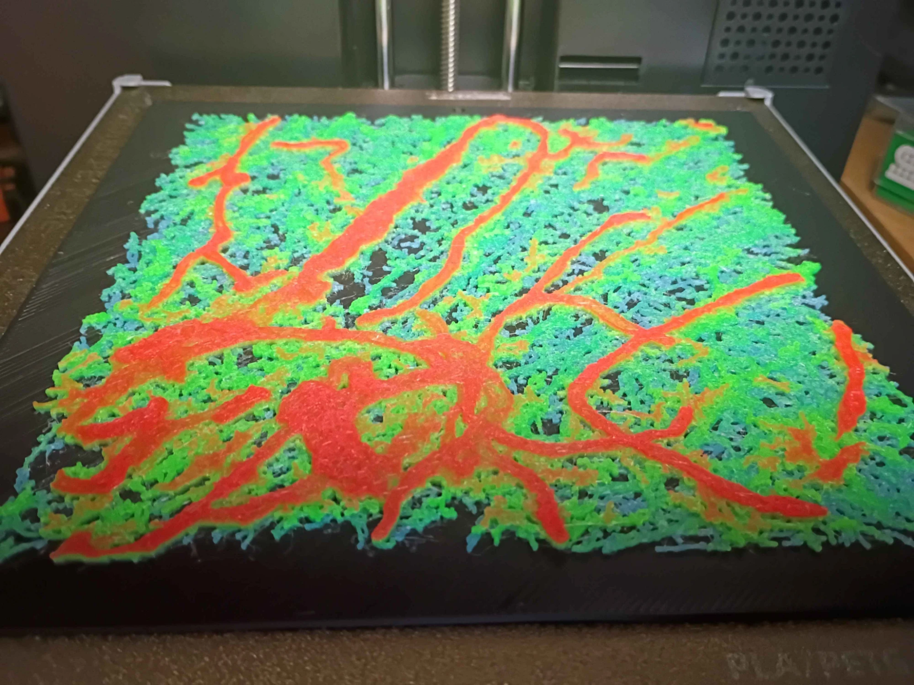
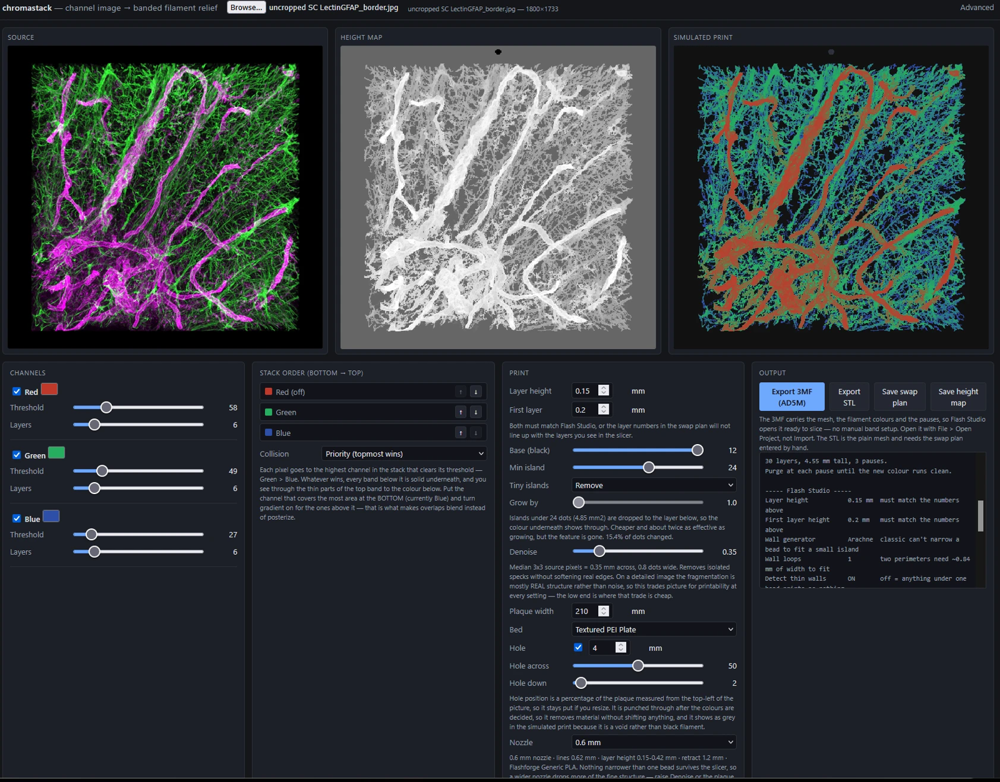

# chromastack

chromastack turns a three-channel fluorescence image into a 3D print, with one
filament colour per channel. It is a single HTML file that runs in the browser, and the image
never leaves your computer. It exports a ready-to-print project for the Flashforge Adventurer
5M with the filament swaps already set, or a plain STL for any printer.

## How it works

The print is a banded filament relief: a black base, then one Z band per colour
channel, with a manual filament swap at each band boundary. Each pixel's column
rises into the band of the topmost channel that clears its threshold, and how far
it rises tracks that channel's intensity, so a thin top band over a solid band
underneath reads as a blend. The preview composites the whole stack and is
derived from the final geometry, so what the panel shows is what gets sliced.

The mesh is a stepped height field: every sample is a flat cell at its own
height, with the walls between them subdivided at shared corners so it is
watertight. Ramping between samples was tried first and erased most of the
bottom channel, so it is not done.

## Use

1. Download `chromastack.html` and open it in a browser. No install, no server,
   no dependencies.
2. Load an image. It was built for three-channel immunofluorescence micrographs;
   any RGB image works.
3. Set each channel's threshold and colour, the print width, layer height and
   nozzle.
4. Export.

Controls worth knowing about, all documented in the page:

- Denoise: median filter on the source before sampling, in millimetres.
- Min island / Tiny islands / Grow by: islands too small to print, per layer,
  are either grown by a bounded disc (adds material, keeps every feature) or
  removed (drop to the layer below).
- Nozzle: 0.25, 0.4, 0.6 or 0.8 mm. Swaps the machine settings and line widths,
  and clamps layer height into that nozzle's legal range.
- Hole: a hanging hole, punched after the colours are decided.

## Exports

- **3MF (Flashforge Adventurer 5M):** a complete Flash Studio project: mesh,
  filament palette, per-band filament assignment, and PausePrint markers on the
  first layer of each new colour. Open it with File > Open Project, not Import.
  Needs a browser with CompressionStream (Chrome/Edge 103+, Firefox 113+,
  Safari 16.4+).
- **STL:** the bare mesh, for any printer. Enter the filament swaps by hand from
  the swap plan.
- **Swap plan** (text) and **heightmap** (PNG).

## Printers

The 3MF export targets the Flashforge Adventurer 5M on stock firmware, sliced in
Flash Studio. Its machine and filament settings come from that printer's
profiles (Flashforge Generic PLA, one overlay per nozzle size). The STL export
works with any printer and slicer that can pause for a filament change.

## License

Copyright (C) 2026 Garrick Salois. Licensed under the GNU Affero General Public
License v3.0 (see `LICENSE`). The AD5M settings embedded in the 3MF export are
derived from the Flashforge / Orca-Flashforge printer profiles, which are
AGPL-3.0.
